<div align="center">

# 🎙️ Recorder

### Sing, see your pitch as a glowing line, and auto-tune it in real time.

A browser studio for your voice: a piano-roll pitch visualizer, real-time auto-tune and harmonizer,
multi-track songs over imported beats, effects and a mixer. Every DSP algorithm is written from scratch
in TypeScript.

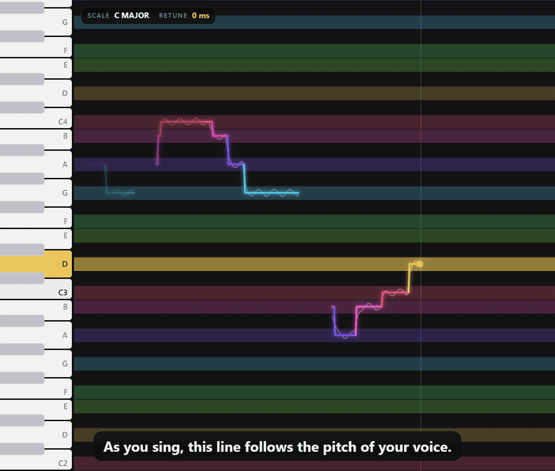

<br />


</div>

---

## Contents

- [Features](#features)
- [Quick start](#quick-start)
- [How to use it](#how-to-use-it)
- [How it works](#how-it-works)
- [Project structure](#project-structure)
- [Development](#development)
- [Browser support](#browser-support)
- [Roadmap](#roadmap)
- [Credits & licenses](#credits--licenses)

---

## Features

### 🎵 See your voice: a live pitch line over piano lanes

Each lane is one key on a piano. As you sing, a glowing line follows your pitch. With **auto-tune** on, it
becomes a **staircase**, each step snapped to a note, and the key and lane light up in their colour.
Pick a **key and scale**: out-of-scale lanes disappear, and the keyboard shows the note letters.

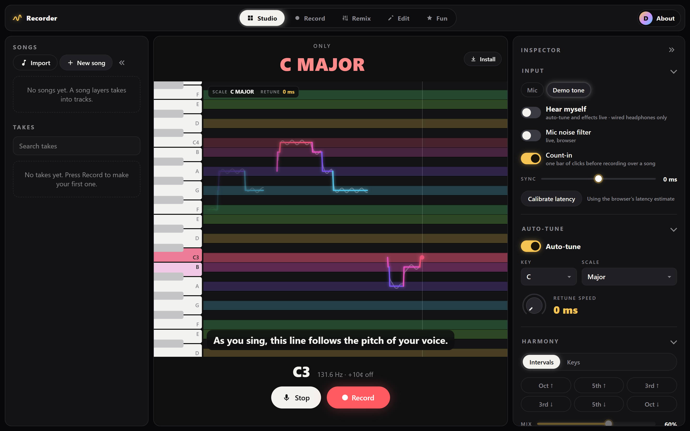

- **Pitch detection:** our own YIN implementation (about 100 frames a second) with a median filter. A
  readout shows the note, its frequency and how many cents off you are.
- **Retune speed** knob, 0–400 ms: 0 ms gives the instant robot staircase (the "Believe" sound), slower
  settings glide into each note and let vibrato through.
- **Scales:** Chromatic, Major, Minor, Harmonic minor, Major/Minor pentatonic and Blues, in any key.

### 🎶 One voice, many notes: the harmonizer

Stack harmony voices a 3rd, 5th or octave above or below your **auto-tuned** melody. They move by
*scale steps*, so harmonies stay in key, and every voice gets its own glowing line.

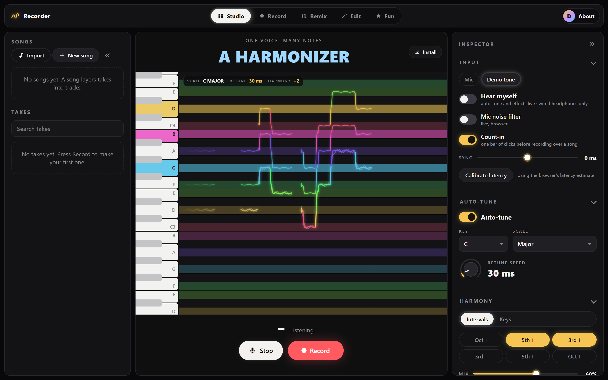

### 🎧 Hear yourself live

Turn on **Hear myself** and sing with auto-tune, harmonies and effects **in your headphones as you sing**.
Processing adds about **25 ms**, and the panel shows the total delay from mic to ears and the CPU use.
Harmony voices are dropped automatically if the device can't keep up. Takes are still recorded **dry**,
so every setting stays changeable afterwards.

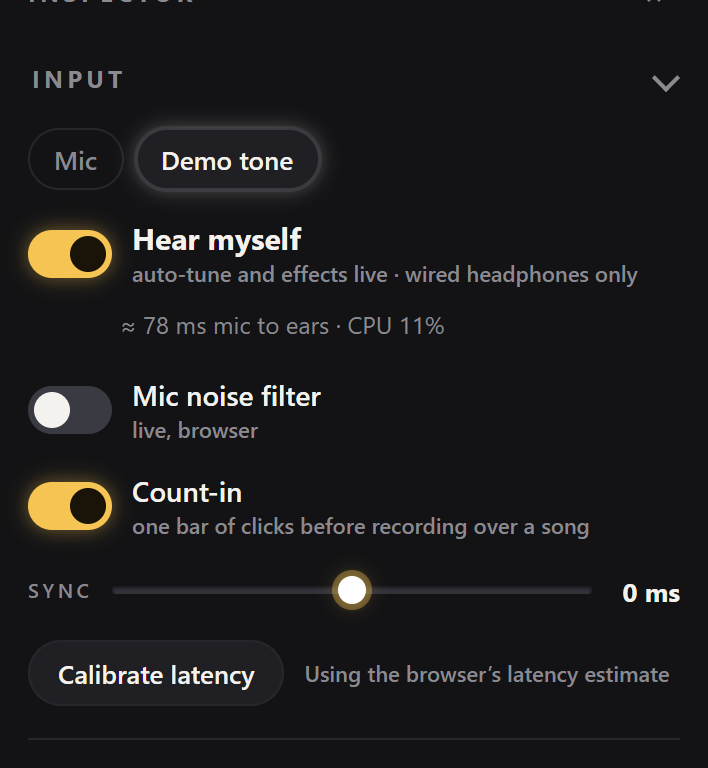

> **Use wired headphones.** Speakers feed back into the mic, and Bluetooth adds 150–300 ms of delay.

### 🎛️ A studio for songs

Import a beat (MP3, WAV, M4A, OGG, FLAC), sing over it, and layer takes into tracks. The key and tempo are
**detected automatically**, and auto-tune can follow the detected key with one click.

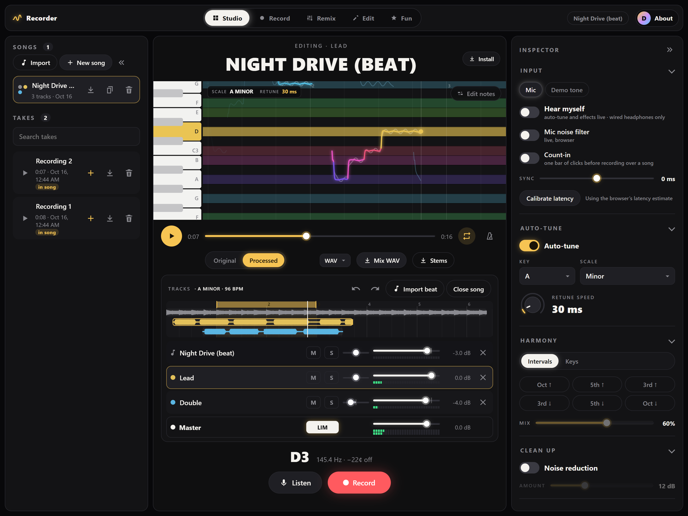

- **Record over the beat** with a count-in and latency compensation: takes land in time. There's a
  loopback calibration and a manual sync nudge.
- **Tracks & mixer:** fader, pan, mute/solo and peak meters per track, plus a master with a true
  look-ahead limiter. Undo/redo for every edit.
- **Timeline:** waveform clips you can drag (snapping to 1/16 notes); drag along the ruler for a
  **loop region**.
- **Metronome & grid:** a click on the song's tempo while it plays and while you record (with an
  accented bar 1 and a count-in on the beat). Bar and beat lines run across the piano roll and the
  timeline. The tempo *and where the bars start* are detected from the beat. You can also type a BPM,
  tap it in, or set bar 1 at the playhead. One click (<kbd>Q</kbd>) moves a take so its first note
  lands on the beat.
- **Ghost lines:** the other vocal tracks are drawn faintly behind the one you're editing.
- **Workspace modes:** a top bar switches between **Studio**, **Record**, **Remix**, **Edit** and **Fun**
  (<kbd>1</kbd>–<kbd>5</kbd>). Each shows just the controls that job needs.
- **Your layout:** close the Songs column or the inspector to a thin rail (<kbd>[</kbd> <kbd>]</kbd>), and pop any
  inspector section (Auto-tune, Harmony, Effects…) out into a floating window you can drag next to the roll.
- **Everything is instant:** auto-tune, harmony, pitch, voice character, clean-up and the song's key shift
  are all heard on the **next audio block** while the song plays. Playback never restarts and nothing
  is ever re-rendered.

<p align="center">
  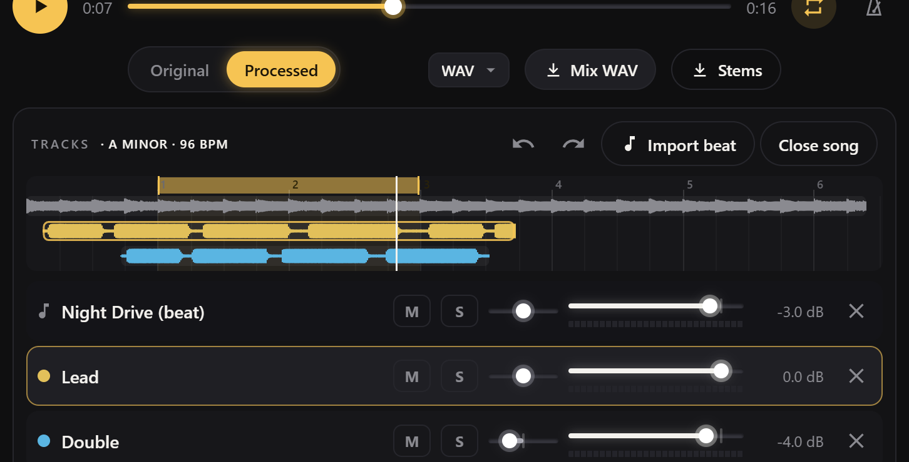
</p>

### ✏️ Edit the notes you sang

Press **Edit notes** (<kbd>N</kbd>) and every sung note shows up as a blob on the piano roll. Drag a
note up or down to sing it on another pitch (whole semitones; hold <kbd>Alt</kbd> for cents). Drag it
sideways to move it in time (it snaps to the song's grid), or by its ends to make it longer or shorter.
The pitch stays put while it stretches. You can also give a note its own correction strength. Every edit is
non-destructive, can be undone, and is heard straight away while the song plays (and in exports).

<p align="center">
  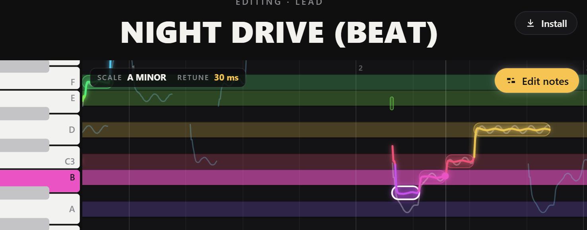
</p>

### 🎹 Play the harmony

Switch the Harmony section to **Keys** and hold notes, either on the keyboard at the left of the roll
(click to latch, so a mouse can hold chords) or on a **MIDI keyboard**. Your voice sings every held note
at once, Jacob Collier style, live in your headphones while you sing. Voices sit near your own pitch
(or exactly as played) and keep your vibrato. Takes you record into a song remember the keys, so the
harmony plays back and exports exactly as you heard it.

<p align="center">
  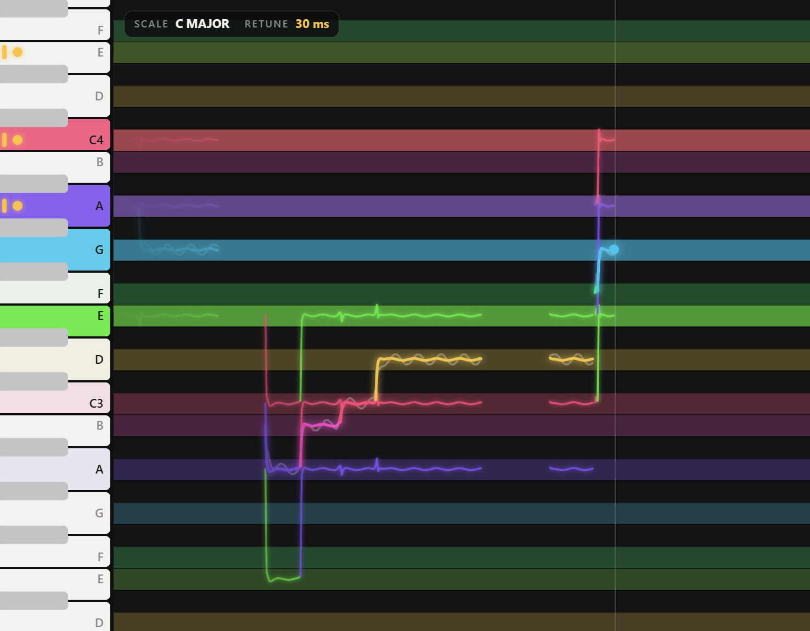
</p>

### 🎭 Voice character

Turn your voice into someone else's: **Deeper**, **Younger**, **Chipmunk**, **Monster**, **Robot**
(each phrase held on one note) or **Whisper** (your vowels, no pitch). Under the hood a **formant shift**
moves the vowel colour without changing the pitch, so a voice can sound bigger or smaller and still sing
the same notes. It works during playback, in exports and live in your headphones.

### 🎚️ Neon controls

Every slider is a custom control. It snaps to "home" values like 0 dB or centre pan (hold
<kbd>Alt</kbd> to place it freely), goes ten times finer with <kbd>Shift</kbd>, shows its value in a
bubble while you drag, and resets with a double-click. The meters are LED-style, and on desktop the
cursor changes with what's under it: a crosshair with the **note name** over the piano roll, ↔ on
clips, loop edges and sliders. Everything stays keyboard- and screen-reader-friendly, and on phones
the controls grow to finger size.

### ✨ Effects

<table>
<tr>
<td width="50%" valign="top">

**Per vocal track**
- Presets: *Clean pop*, *Radio*, *Dreamy*, *Robot*
- Pitch offset ±12 semitones (e.g. an octave-up double), with formants preserved
- High-pass, compressor, 3-band EQ
- Noise gate and de-esser
- Reverb and echo sends

**Per song**
- **Key shift** ±6 semitones: the beat (phase vocoder) *and* the vocals (PSOLA), with auto-tune following
- Reverb: *Room*, *Plate*, *Hall* or *Cathedral*
- Tempo-synced echo (1/4, 1/8, dotted 1/8, 1/16)

**Clean up**, live like everything else
- Spectral noise reduction (the noise profile is learned from your pauses)
- Noise gate and de-esser
- The browser's live mic noise filter

</td>
<td width="50%" valign="top">
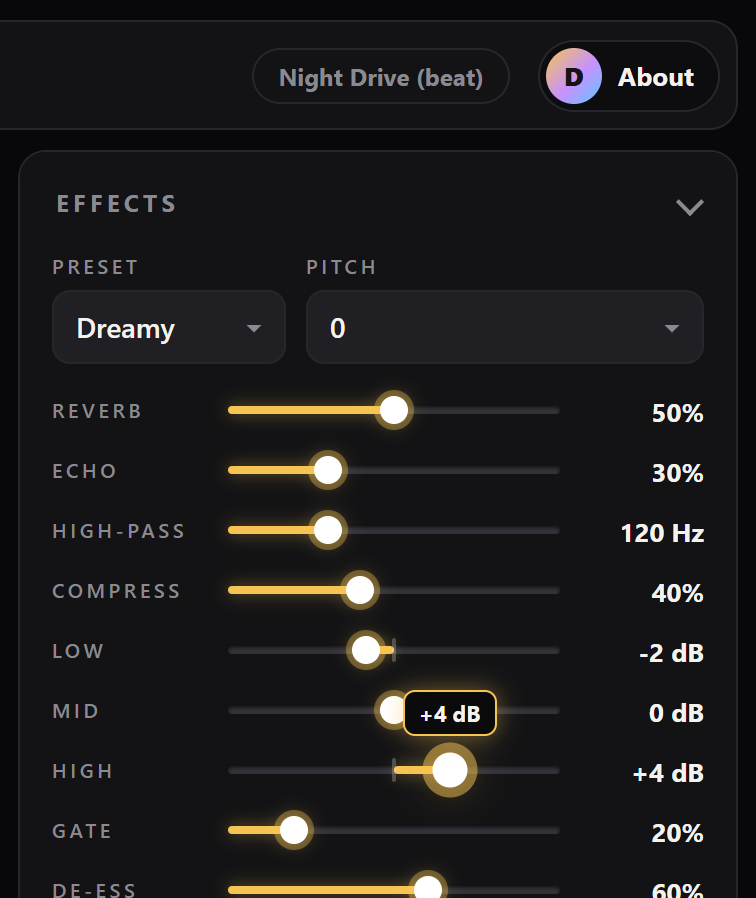
</td>
</tr>
</table>

### 💾 Export & share

- **WAV or MP3** of a take, a processed take or the whole mix (through the same engine you hear).
- **Stems:** every track as its own WAV, zipped, all the same length for any DAW.
- **`.recsong` song files:** a whole song (takes, pitch data and the beat) in one file, to back it up or
  open on another device.

### 📱 Works on your phone, installable

A responsive layout gives three columns on desktop, a drawer on tablets and bottom tabs on phones. It's
an installable **PWA** that works offline once installed.

<p align="center">
  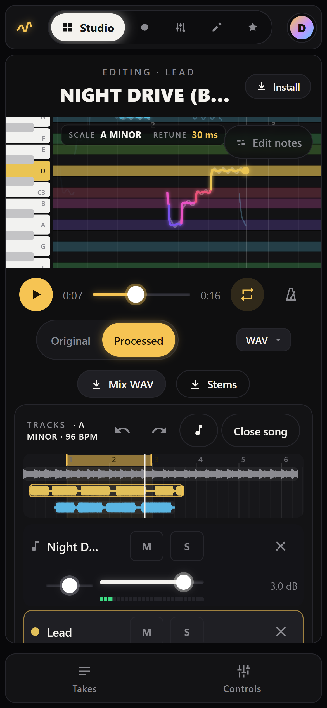
  &nbsp;&nbsp;
  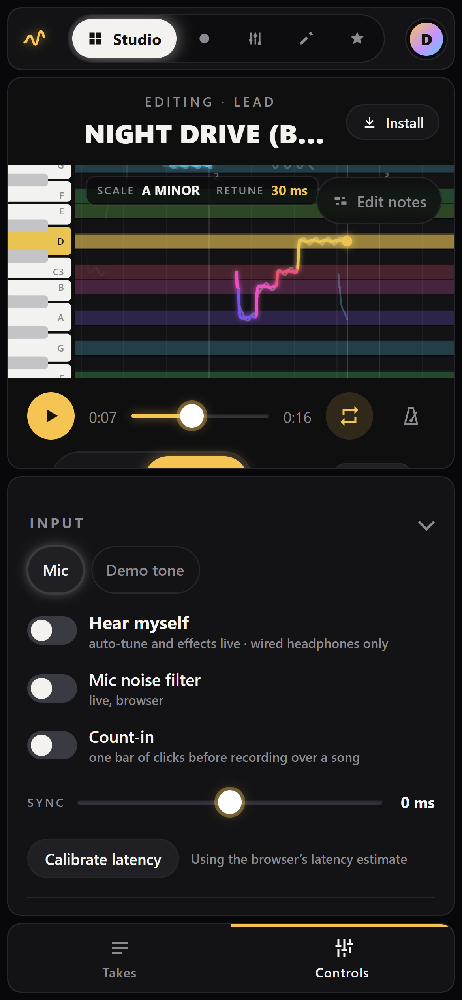
</p>

---

## Quick start

Requires **Node.js 20.19+ or 22.12+** and a Chromium-based browser (see [browser support](#browser-support)).

```bash
npm install
npm run dev
```

Open <http://localhost:5173>. No microphone handy? Pick **Demo tone** in the Input section: a
synthetic voice sings through the exact same pipeline.

**On your phone:** browsers only give microphone access over HTTPS. Run this, open the printed
`https://<your-ip>:5173` on the phone and accept the self-signed certificate warning:

```bash
npm run dev:lan
```

## How to use it

1. **Listen** shows your pitch line live; **Record** also saves a take.
2. Turn on **Auto-tune**, pick a key and scale, and set the retune speed. Press Play to hear the tuned take,
   and switch **Original ↔ Processed** to compare.
3. Add **Harmony** voices, or turn on **Hear myself** (with headphones) to hear it all while you sing.
4. Make a **song**: *Import* a beat (or drop an audio file anywhere), accept the detected key, then
   **Record** to add vocal tracks over it.
5. Mix, add effects, loop a section, and **export** a WAV/MP3, stems or a `.recsong` file.

### Keyboard shortcuts

| Key | Action |
|---|---|
| <kbd>R</kbd> | Record / stop |
| <kbd>Space</kbd> | Play / pause |
| <kbd>T</kbd> | Auto-tune on / off |
| <kbd>A</kbd> | Original ↔ processed |
| <kbd>L</kbd> | Loop on / off (song open) |
| <kbd>M</kbd> | Click (metronome) on / off (song open) |
| <kbd>Q</kbd> | Align the selected take's singing to the nearest beat |
| <kbd>1</kbd>–<kbd>5</kbd> | Workspace mode: Studio, Record, Remix, Edit, Fun |
| <kbd>[</kbd> <kbd>]</kbd> | Close / open the Songs & Takes column and the inspector (desktop) |
| <kbd>N</kbd> | Edit notes on / off; then <kbd>↑</kbd> <kbd>↓</kbd> pitch (<kbd>Shift</kbd> = 0.1 st), <kbd>←</kbd> <kbd>→</kbd> next note, <kbd>Delete</kbd> reset, <kbd>Esc</kbd> done |
| <kbd>Ctrl</kbd>+<kbd>Z</kbd> / <kbd>Ctrl</kbd>+<kbd>Shift</kbd>+<kbd>Z</kbd> | Undo / redo (song open) |
| <kbd>←</kbd> <kbd>→</kbd> | Nudge the selected clip (timeline focused; <kbd>Shift</kbd> = ×4) |
| <kbd>Alt</kbd> + drag | Move clips / loop edges without snapping |

---

## How it works

Everything runs **in your browser**: no server, no account, nothing uploaded. Takes and songs live in
IndexedDB.

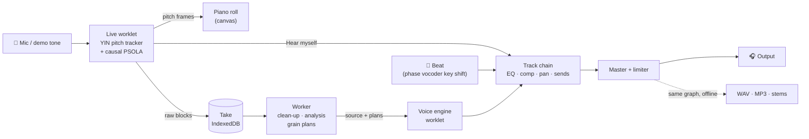

<details>
<summary><b>Pitch detection: YIN</b></summary>

The audio is decimated to ~22 kHz. Every 10 ms the **YIN** difference function compares the
signal with a shifted copy of itself: the shift where it matches best is one period of your voice. A
cumulative-mean normalisation plus a threshold picks the fundamental and avoids octave errors, and a
median-of-3 filter removes one-frame spikes. Silence and breaths count as unvoiced (gaps in the line).

</details>

<details>
<summary><b>Auto-tune curve</b></summary>

For each pitch frame, the target is the nearest note in the scale, with 0.15 semitone of hysteresis so
a voice between two notes doesn't flicker. The correction is a *shift* added to the sung pitch and
smoothed with a time constant of `retune / 3`. At 0 ms you get the exact staircase. Slower settings pull
the average onto the note while letting vibrato through, like classic hardware auto-tune.

</details>

<details>
<summary><b>Pitch shifting: TD-PSOLA, as a real-time generator</b></summary>

**TD-PSOLA** cuts the voice into two-period grains around one *analysis mark* per cycle (on the peaks of
a low-passed copy), then overlap-adds them at the corrected spacing. Grains are moved, never
resampled, so the **formants stay put**: it still sounds like you, just on pitch. Unvoiced sounds
(breaths, "s") pass through untouched.

During playback the whole take is known in advance, so the voice engine is a **generator**:
1. **Analysis (once per take, in a worker):** voiced regions and marks.
2. **Grain plan (on every settings change, a few milliseconds):** where each grain goes for this
   correction curve.
3. **Render (on the audio thread):** an AudioWorklet overlap-adds whatever song position the transport
   asks for, without allocating anything.

Turning a knob only replaces the plan, so changes are audible on the next 128-sample block. Exports
render the same worklet in an `OfflineAudioContext`, and tests check that block rendering is
**bit-identical** to rendering the whole take.

For **Hear myself**, `LiveVoice` runs a causal version on the mic: marks are placed as soon as a whole
cycle has arrived, and synthesis runs a fixed 25 ms behind the input.

</details>

<details>
<summary><b>Instrumental key shift, noise reduction, key & tempo detection</b></summary>

- **Phase vocoder** with identity phase locking (2048/512 STFT) time-stretches the beat, then a
  Catmull-Rom read-out brings it back to length at the new pitch, streamed live in a worklet. Stereo
  shares one complex FFT, and phase locking is a rotation per peak. Accurate to ~5 cents on chords.
- **Voice character:** grains are read faster or slower (formants move, pitch doesn't), or replaced
  by noise shaped by their own LPC envelope (whisper).
- **Noise reduction:** an STFT Wiener filter (43 ms Hann frames, 75% overlap, decision-directed). The
  noise profile comes from the quietest 15% of frames. About +9 dB SNR while the voice keeps ~97% of
  its level.
- **Key detection:** a 55 Hz–2 kHz chroma correlated with the 24 Krumhansl–Kessler key profiles.
- **Tempo:** autocorrelation of a spectral-flux onset envelope, 60–200 BPM, with a tempo prior. Bar 1
  is the beat phase with the strongest comb of onsets, then the strongest of the 4 beats (downbeats
  hit hardest).
- **Metronome:** a worklet that clicks on the beats of whatever song position the transport plays, so
  it stays on the beat through seeks and loop wraps.
- **Reverb:** impulse responses generated from seeded, filtered, decaying noise, so no sample files ship.

</details>

<details>
<summary><b>Timing: recording in sync with the beat</b></summary>

The mic and playback share **one `AudioContext` clock**, and the mic worklet stamps every block with its
context frame. A take's position = song position + (first sample − playback start) − round-trip
latency − mix-chain delay + nudge. The round trip is the browser's estimate or a measured loopback
calibration (6 clicks through the speakers, onsets found in the mic signal). The mix chain's own delay
(compressor look-ahead, the limiter's oversampling; about 15 ms in Chrome) is measured once by
rendering an impulse offline, and the click is delayed by the same amount, so it sits exactly on the
beat. In the app, a take recorded after a count-in landed within 10 ms of the predicted position.

</details>

---

## Project structure

```
src/
  app/        store, session (the engine: input, takes, songs, playback, exports), pure helpers
  dsp/        pure, unit-tested DSP: YIN, auto-tune, PSOLA, voice engine, live voice, harmony,
              phase vocoder, denoise, dynamics, limiter, reverb IRs, key/tempo analysis, FFT
  audio/      Web Audio: mix player, mix chain, mixdown, worklets (engine/), worker, WAV/MP3/ZIP
  project/    song model, effects, undo history, .recsong files
  storage/    IndexedDB (self-healing upgrades), pitch-track packing, preferences
  ui/         piano roll, timeline, knob, captions, panels/ (one module per UI section)
tests/        Vitest: DSP with synthesized signals, storage, model, engine parity
scripts/      icon generator, README screenshot capture
```

Design rules: **DSP stays pure** (no DOM or Web Audio) so it can be tested with synthesized signals;
**UI panels never talk to each other**, they read a small typed store and call session actions; there's
no UI framework. [`CLAUDE.md`](CLAUDE.md) holds the full design log: every decision, measurement and
checklist.

## Development

| Command | What it does |
|---|---|
| `npm run dev` | Dev server at <http://localhost:5173> |
| `npm run dev:lan` | HTTPS dev server on your network (phone mic testing) |
| `npm run build` | Type-check + production build (with a service worker) into `dist/` |
| `npm run preview:lan` | Build + HTTPS preview on your network |
| `npm test` | 174 unit tests (Vitest) |
| `npm run icons` | Regenerate the PWA icons (procedural, no dependencies) |
| `npm run screenshots` | Regenerate these README screenshots with headless Chrome (needs `npm run dev` running; the GIF needs `ffmpeg`) |

In `npm run dev`, `window.recorder` exposes `{ store, session }` for poking at the engine from the
console. It doesn't exist in production builds.

## Browser support

Developed and tested in **Chromium** (Chrome / Edge, desktop and Android). Firefox and Safari support
everything the app uses (AudioWorklet, OfflineAudioContext, IndexedDB), but they haven't been tested yet.
The microphone needs `localhost` or HTTPS.

## Roadmap

- [x] **v1:** live pitch visualizer, recorder, auto-tune (visual + audio), harmonizer, noise reduction, PWA
- [x] **v2 "Studio":** three-column layout, songs & tracks, beat import with key/BPM detection, recording
      over the beat, mixer, effects, loop, song files, MP3
- [x] **v3 "Real-time & Neon studio"**
  - [x] Real-time voice engine: every change instant during playback
  - [x] Hear yourself live: monitoring with auto-tune, harmony and effects
  - [x] Clean-up and the beat's key shift live too, plus voice character (formant shift, robot, whisper)
  - [x] "Neon studio" UX: custom sliders with snapping, context cursors, LED meters
  - [x] Metronome & grid: click, count-in on the beat, tap tempo, bar/beat lines, align takes to the beat
  - [x] Note editing: drag sung notes to new pitches and times, per-note correction
  - [x] Play-the-keys harmony: on-screen keys or a MIDI keyboard, live and recorded with the take

## Credits & licenses

- MP3 export uses **[LAME](https://lame.sourceforge.io/)** via
  [`@breezystack/lamejs`](https://www.npmjs.com/package/@breezystack/lamejs) (LGPL-3.0), unmodified and
  loaded in its own worker only when exporting MP3. See [THIRD_PARTY_NOTICES.md](THIRD_PARTY_NOTICES.md).
- The look and the explanations follow a short explainer video about how auto-tune works.
- Built with [Claude Code](https://claude.com/claude-code).

**License:** [MIT](LICENSE) © 2026 DanixMP. The MP3 encoder keeps its own LGPL-3.0 license (see above).

**Privacy:** recordings, songs and settings stay in your browser; nothing is uploaded and there is no
tracking. The only optional network request is the author's GitHub card in the About panel, and it's
made only when you click "Load from GitHub".
